<!-- vulwiki-editorial:start -->
## 校订与适用边界

### 本次收录记录
- 2026-11-17 周维护收录：来源 gelusus/wxvl 公众号漏洞文库；文本全文审阅完成；未执行任何 PoC、依赖安装或目标访问。
- 触发材料（请求/指纹/规则）保留在下方原文中，未做脱敏或删改。
- CVE/产品查重：无重复主入口（本库 master 6314 篇正文级搜索无既有条目）

### 尚未解决的证据缺口
- 影响版本为来源声明，未与厂商公告逐一核对
- 复现截图像素未查看，技术结论以原文文字为准
- 修复状态为来源声明，需按分支核对补丁版本
<!-- vulwiki-editorial:end -->

## 技术正文与历史材料

> 以下为来源原文全文（保留原始字节，含广告与联系方式的保留原文）。

#  CVE-2026-22218Chainlit 框架任意文件读取漏洞全解析  
标准云
                    标准云  蚁景网络安全   2026-11-04 09:32  
  
## 漏洞简介  
  
Chainlit  是一个开源的 Python 框架，专门用于快速构建对话式人工智能（Conversational  AI）应用程序和大语言模型（LLM）接口。该框架基于 FastAPI 和 Socket.IO  构建，提供了丰富的用户界面组件和实时通信能力，使开发者能够轻松创建类似 ChatGPT 的对话界面。Chainlit 广泛应用于聊天机器人、AI  助手、客户服务系统等场景，支持多种 LLM 后端（如 OpenAI、Anthropic Claude、LangChain  等）的集成，并提供了完善的用户认证、会话管理、文件处理等企业级功能。  
  
‍  
  
核心问题：Chainlit 在处理自定义元素（Custom Element）时，没有对用户传入的文件路径做任何验证，也没有对未认证用户进行有效拦截，导致任意人都可以让服务器读取其本地任意文件并通过接口返回给攻击者。  
  
更具体地说，这个漏洞由两个独立的代码缺陷叠加形成：  
- 缺陷一：权限检查形同虚设——当服务器未配置强制身份认证时，核心接口的 if current_user 判断直接被跳过  
  
- 缺陷二：路径完全不做校验——用户传入的 path 字段被原封不动地传入文件读取函数，攻击者可以指向服务器上任意位置  
  
这两个缺陷单独看都算严重，组合在一起就造成了"无认证+任意文件读取"的高危漏洞  
  
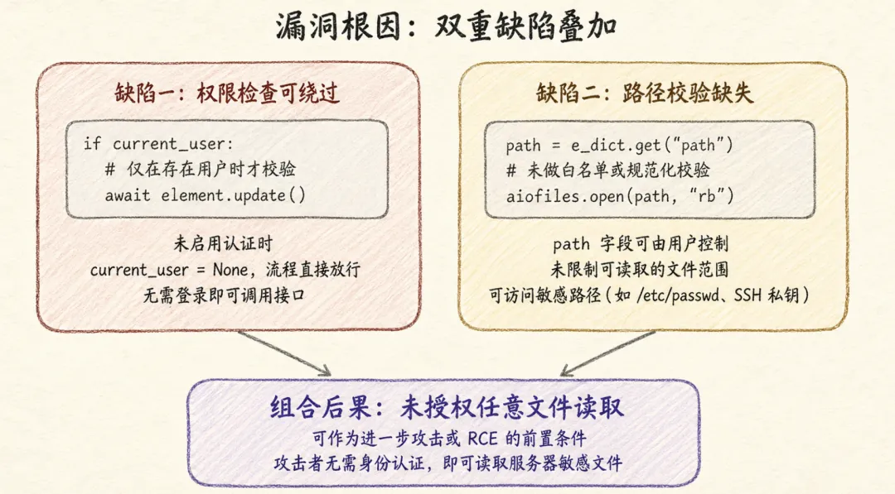  
  
## 漏洞复现  
  
整个攻击分为两步，合计只需两次 HTTP 请求加一个 WebSocket 连接：  
- 第一步：向 /project/element 发送 PUT 请求，在请求体中注入一个包含任意文件路径（如 /etc/passwd）的 path 字段，触发服务器读取该文件并缓存，同时通过 WebSocket 获得一个"文件令牌"（chainlitKey）  
  
- 第二步：携带这个文件令牌访问 /project/file/{chainlitKey}，服务器直接把刚才读取的文件内容返回给攻击者  
  
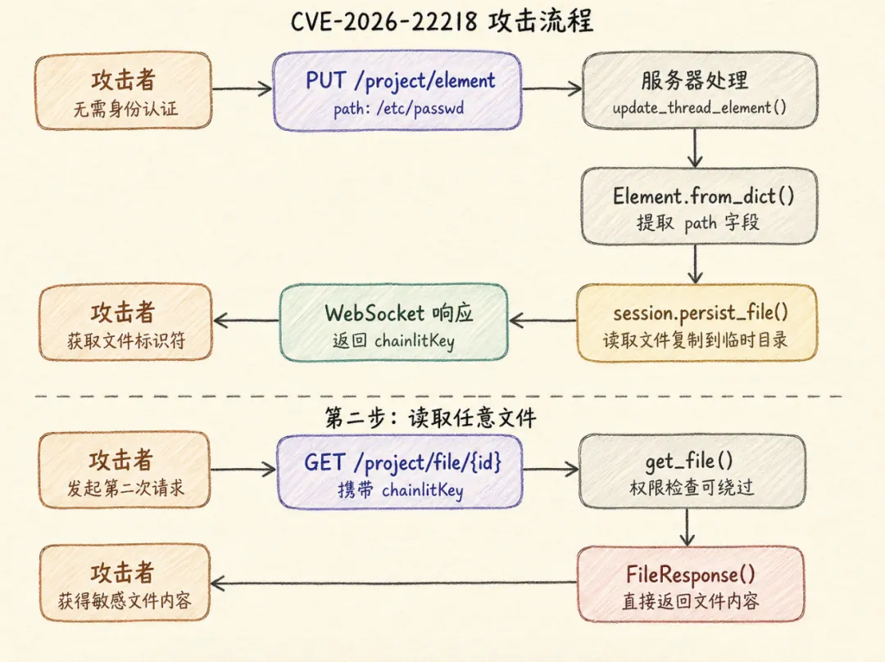  
  
  
创建一个 demo.py  
```
import chainlit as cl@cl.step(type="tool")async def tool():    # Fake tool    await cl.sleep(2)    return "Response from the tool!"@cl.on_message  # this function will be called every time a user inputs a message in the UIasync def main(message: cl.Message):    """    This function is called every time a user inputs a message in the UI.    It sends back an intermediate response from the tool, followed by the final answer.    Args:        message: The user's message.    Returns:        None.    """    # Call the tool    tool_res = await tool()    await cl.Message(content=tool_res).send()
```  
  
利用 python 虚拟环境 方便搭建环境  
```
python -m venv venvvenv\Scripts\Activate.ps1python -m pip install chainlit==2.9.3 #安装存在漏洞的 chainlit 版本chainlit run demo.py -w
```  
  
  
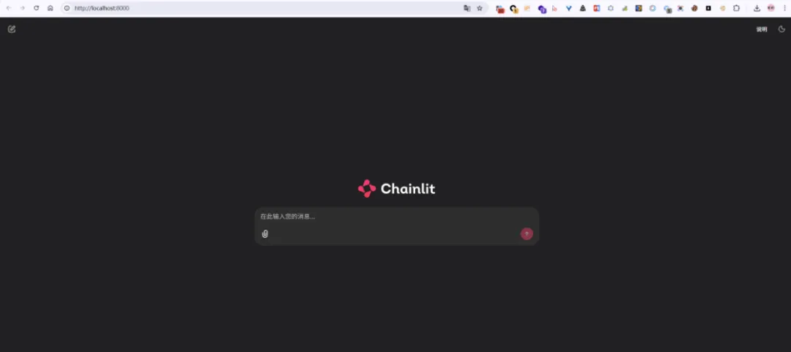  
  
  
运行构造好的 chainlit_file_read_exploit.py 指定 url 和需要读取的文件内容，就可以将文件打印出来  
  
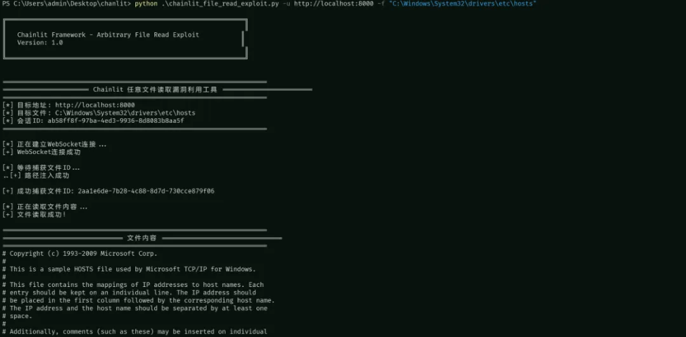  
  
## 漏洞分析  
  
**第一步**  
是通过调用 PUT /project/element  
 接口注入恶意文件路径，当攻击者在请求参数中传入包含任意路径的 path  
 字段时（如 /etc/passwd  
），服务器端的 persist_file()  
 函数会读取该路径指定的文件内容并将其复制到临时目录中，同时将临时文件路径与一个随机生成的文件标识符（file_id）建立映射关系并注入到当前会话的文件映射表（session.files  
）中，随后服务器通过 WebSocket 消息将这个文件标识符（chainlitKey）推送给客户端，攻击者需要监听 WebSocket 连接来捕获这个关键的文件ID。  
  
‍  
  
server.py[#update]()  
_thread_element  
  
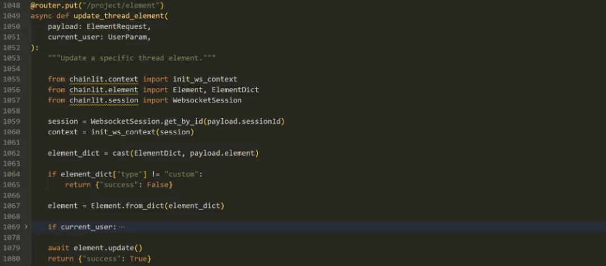  
  
  
update_thread_element  
 函数接收到请求后，首先调用 Element.from_dict()  
 方法解析请求体中的元素字典，该方法根据 type  
 字段判断元素类型并创建对应的对象实例，当 type  
 为 custom  
 时会创建 CustomElement  
 对象，随后服务器调用该对象的 update()  
 方法。  
  
‍  
  
element.py[#from]()  
_dict  
  
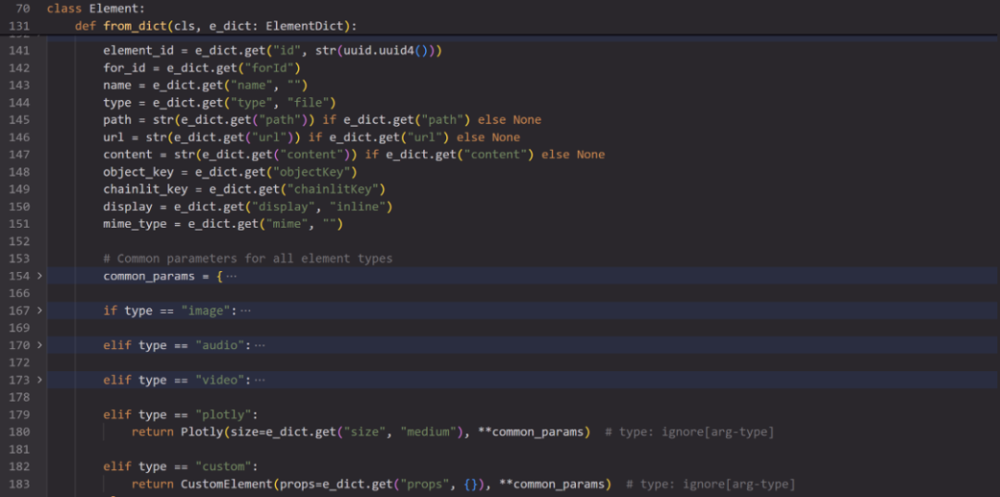  
  
  
在创建过程中 from_dict()  
 方法会提取请求中的所有字段包括用户可控的 path  
 字段并传递给对象构造函数，此时恶意路径（如 /etc/passwd  
）被完整保存到 CustomElement  
 对象的 path  
 属性中。  
  
‍  
  
element.py[#CustomElement]()  
[#update]()  
  
  
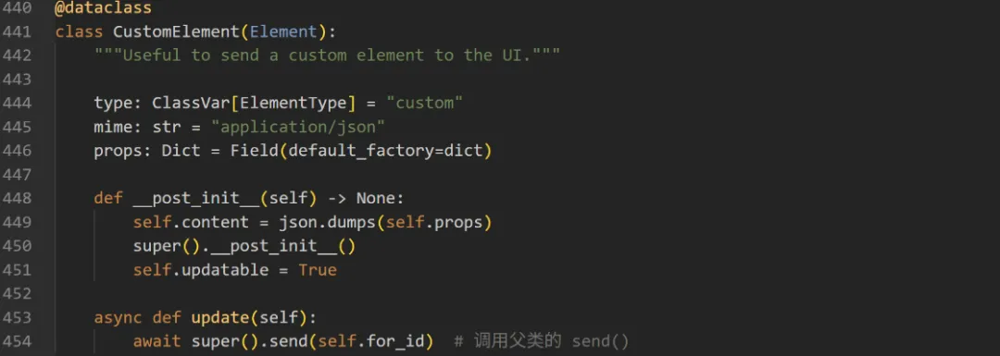  
  
  
调用CustomElement  
的 update()  
 方法，该方法内部会调用父类 Element  
 的 send()  
 方法。  
  
‍  
  
element.py[#Element]()  
[#send]()  
  
  
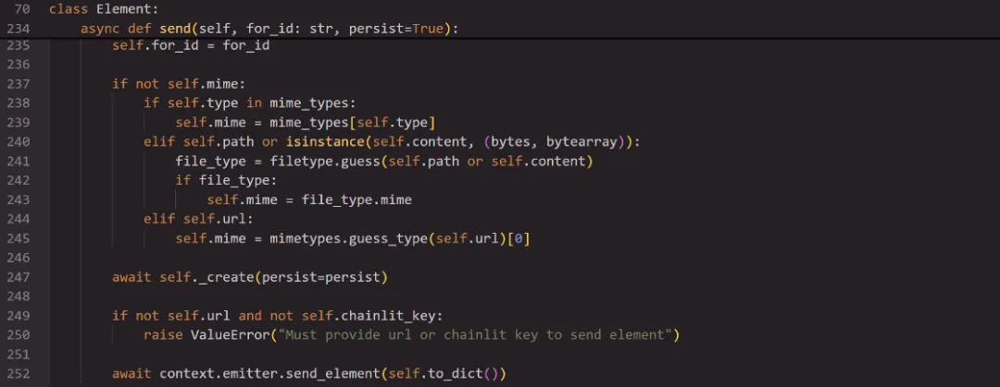  
  
首先 send()  
 方法调用 await self._create(persist=persist)  
 执行文件持久化处理  
  
‍  
  
element.py[#Element]()  
[#create]()  
  
  
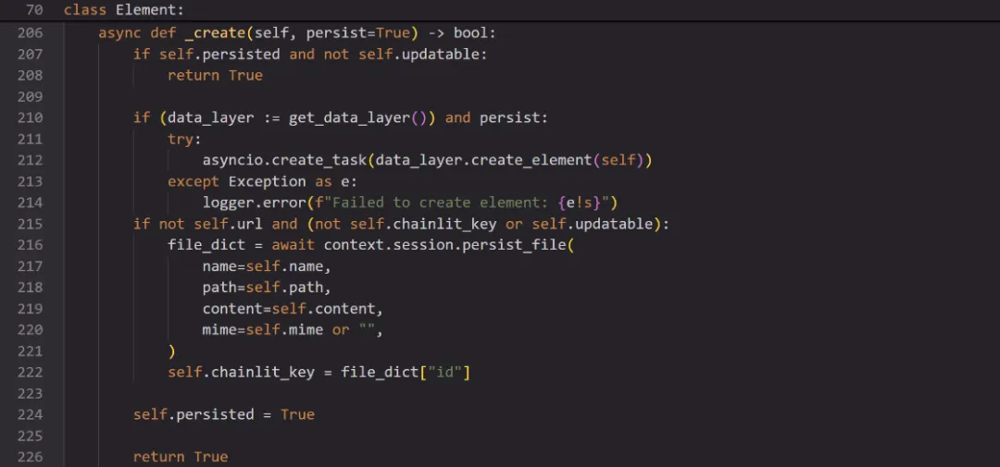  
  
  
_create()  
 方法检测到对象存在 path  
 属性后会调用 session.persist_file()  
 函数  
  
‍  
  
session.py[#BaseSession]()  
[#persist]()  
_file  
  
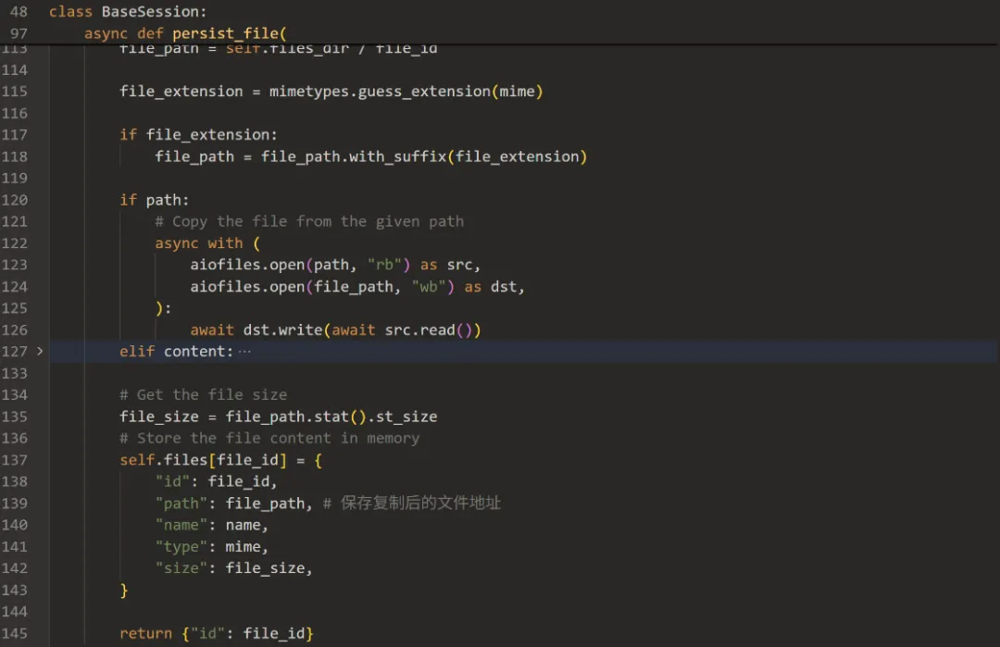  
  
  
session.persist_file()  
 函数，该函数使用 aiofiles  
 异步读取攻击者指定路径的文件内容，将内容复制到会话专属的临时目录中（如 /tmp/chainlit/{session_id}/{file_id}  
），同时生成一个随机的文件标识符（UUID格式），并在会话的文件映射表（session.files  
）中建立该标识符与临时文件路径的映射关系。  
  
‍  
  
element.py[#Element]()  
[#send]()  
  
  
  
  
  
成文件持久化后 send()  
 方法执行第二个关键操作，调用 await context.emitter.send_element(self.to_dict())  
 将元素信息发送到前端  
  
‍  
  
element.py[#Element]()  
[#to]()  
_dict  
  
  
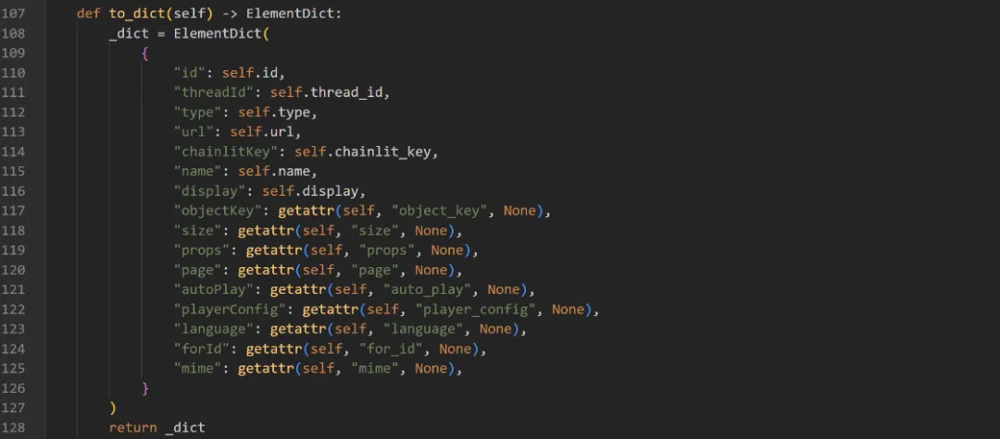  
  
image  
  
  
to_dict()  
 方法负责将 CustomElement  
 对象转换为字典格式，该字典包含对象的所有关键属性如 id  
、type  
、name  
、display  
 以及最重要的 chainlitKey  
（即刚才获得的文件标识符）  
  
‍  
  
emitter.py[#send]()  
_element  
  
  
  
  
  
转换后的字典通过 send_element()  
 方法传递给 emitter  
 的 emit  
 函数  
  
该函数是在 WebSocket 连接建立时注入到会话对象中的闭包函数，它调用 Socket.IO 的全局发送方法将包含 chainlitKey  
 的元素字典通过 WebSocket 推送给客户端，攻击者通过监听 WebSocket 消息流捕获事件名为 element  
 的消息，从消息数据中提取 chainlitKey  
 字段的值即可获得文件标识符，至此完成第一步的路径注入、文件复制和标识符获取操作。  
  
‍  
  
**第二步**  
是使用第一步获得的文件标识符访问 GET /project/file/{file_id}  
 接口来读取文件内容，服务器根据请求中的 session_id  
 参数定位到对应的会话对象，从该会话的文件映射表中查找文件ID对应的临时文件路径，由于权限检查存在 if current_user:  
 的逻辑缺陷，未认证用户可以绕过权限验证，服务器直接使用 FileResponse  
 返回临时文件的内容，而该临时文件已经是目标敏感文件的完整副本，从而实现任意文件读取，整个攻击过程无需任何身份认证，攻击者仅需建立一个匿名 WebSocket 连接即可完成利用。  
  
  
server.py[#get]()  
_file  
  
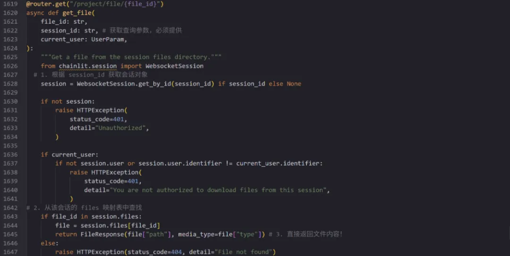  
  
get_file()  
 函数通过 WebsocketSession.get_by_id()  
 方法根据 session_id  
 从全局会话字典中获取对应的会话对象，从该会话对象的 files  
 映射表中查找 file_id  
 对应的文件记录，获取其中存储的临时文件路径，最后使用 FileResponse()  
 直接返回该临时文件的内容给客户端，由于临时文件已经是目标敏感文件的完整副本，攻击者成功获得任意文件的内容。  
## 漏洞修复  
  
目前官方已发布修复版本，建议用户尽快更新至 Chainlit 的修复版本或更高版本：Chainlit >= 2.9.4  
  
官方在 2.9.4 版本中通过引入 _sanitize_custom_element()  
 输入清理函数修复了该漏洞，该函数采用白名单机制重构了 update_thread_element()  
 和 delete_thread_element()  
  两个接口的元素处理逻辑，在创建 CustomElement 对象时仅提取并验证 id、name、display、props  等合法字段，而将用户可控的 path 字段从输入参数中完全排除，使得攻击者即使在请求中注入包含路径遍历字符的恶意 path  值，该字段也会在对象构造阶段被自动过滤丢弃，无法传递到后续的文件操作流程中，从根本上阻断了通过 /project/element  
 接口注入任意文件路径并通过 /project/file/{chainlitKey}  
 接口读取敏感文件的攻击链，有效防止了路径遍历漏洞的利用。  
  
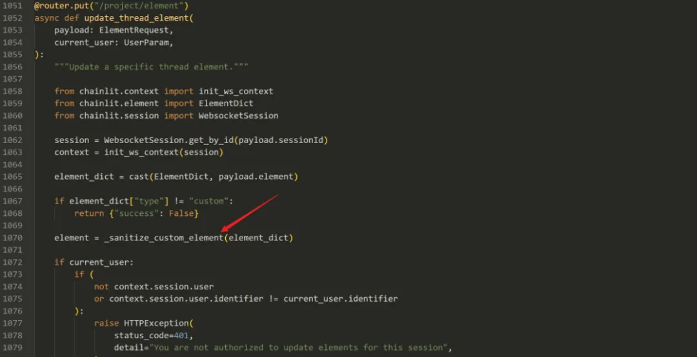  
  
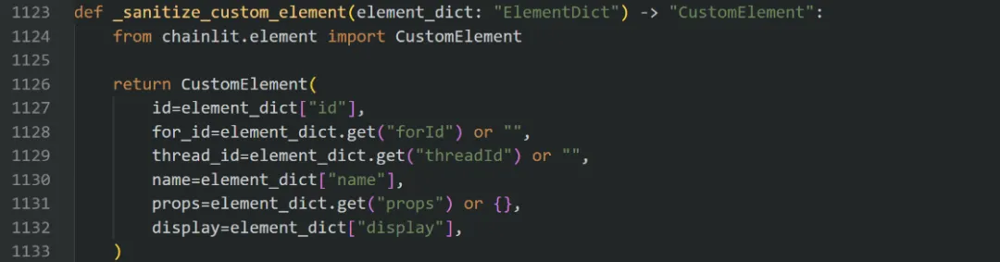  
  
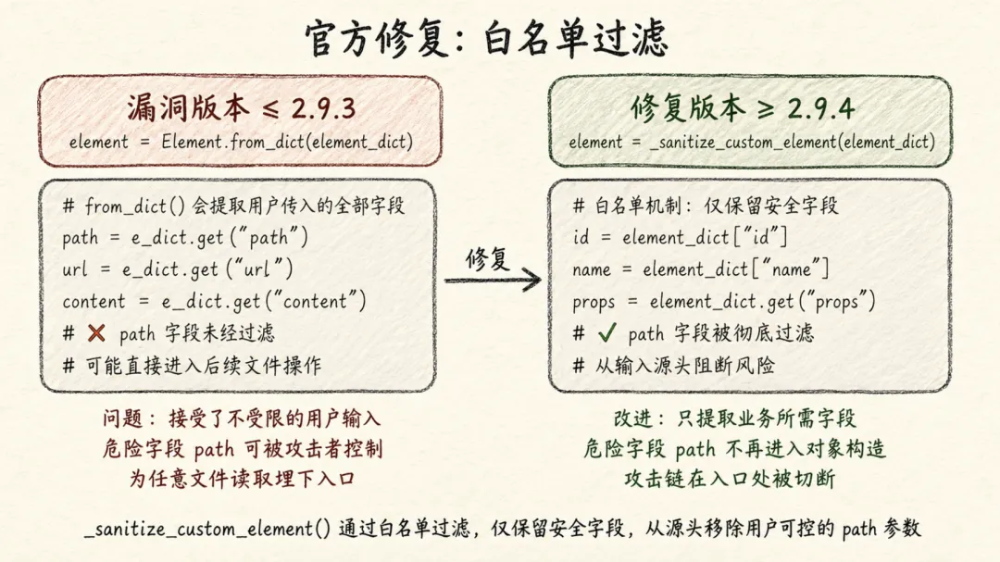

---

> 来源：gelusus/wxvl 公众号漏洞文库（原文见文首链接，归档 URL 见 frontmatter source_url）