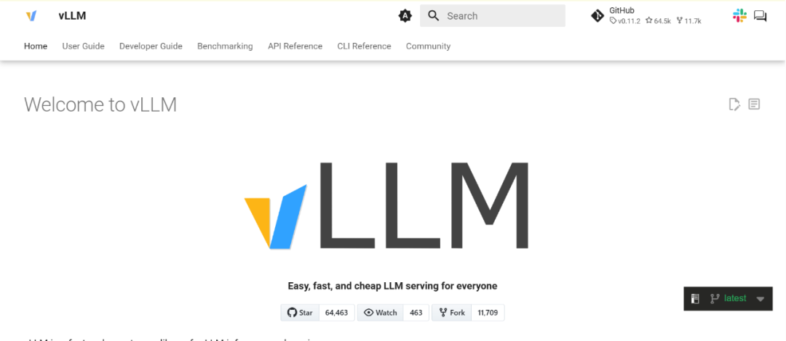

# 漏洞预警 | vLLM远程代码执行漏洞

<!-- vulwiki-editorial:start -->
## 校订与适用边界

### 本次正文校订

- 按该篇完整正文及逐篇审阅区分主问题与背景编号，补全结构化主标识；不把标识归属校订等同运行复现。

### 官方公告补核（2026-10-12）

- 上游 GHSA-7972-pg2x-xr59 与 CVE-2026-27893 对应；影响 >=0.10.1、<0.18.0，修复于 0.18.0。
- 两条模型组件加载路径硬编码 `trust_remote_code=True`，覆盖用户的显式禁用选项。需要加载恶意模型仓库，不能把该问题表述成无需模型加载交互的通用 API 代码执行。
- 已核对编号、版本与修复声明；公众号原文出处尚未定位。后文历史材料、原有测试值和本地图片均保留。

### 核验来源

- https://github.com/vllm-project/vllm/security/advisories/GHSA-7972-pg2x-xr59
- https://github.com/vllm-project/vllm/commit/00bd08edeee5dd4d4c13277c0114a464011acf72

本页为文本校订，未执行代码、PoC 或目标请求；原图仅保留引用，未据此确认复现成功。
<!-- vulwiki-editorial:end -->

## 技术正文与历史材料

浅安
                    浅安  浅安安全   2026-03-31 23:50  
  
**0x00 漏洞编号**  
- # CVE-2026-27893  
  
**0x01 危险等级**  
- 高危  
  
**0x02 漏洞概述**  
  
vLLM是一个高性能的大模型推理框架，专为大规模语言模型的高吞吐量、低延迟部署而设计。  
  
  
  
**0x03 漏洞详情**  
  
**CVE-2026-27893**  
  
**漏洞类型：**  
代码执行  
  
**影响：**  
执行任意代码  
  
**简述：**  
vLLM存在远程代码执行漏洞，在于vllm/model_executor/models/nemotron_vl.py和vllm/model_executor/models/kimi_k25.py文件中，由于代码中硬编码设置trust_remote_code=True，导致用户显式配置trust-remote-code=False被绕过。攻击者可通过构造恶意HuggingFace模型仓库，在模型加载过程中执行任意Python代码，获取服务器执行权限，进而实现系统控制、数据窃取或横向移动。  
  
**0x04 影响版本**  
- 0.10.1 <= vLLM <= 0.18.0  
  
**0x05****POC状态**  
- 未公开  
  
**0x06****修复建议**  
  
**目前官方已发布漏洞修复版本，建议用户升级到安全版本****：**  
  
https://github.com/vllm-project/vllm  
  
  
  

---

> 来源：gelusus/wxvl（微信公众号漏洞文章自动归档，原文见文首链接）
