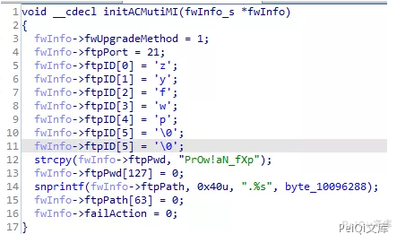
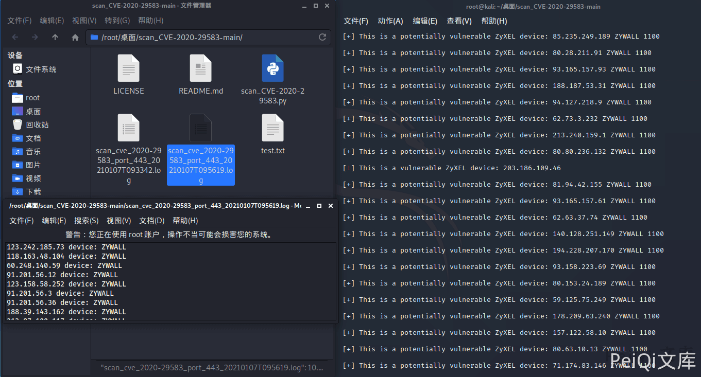
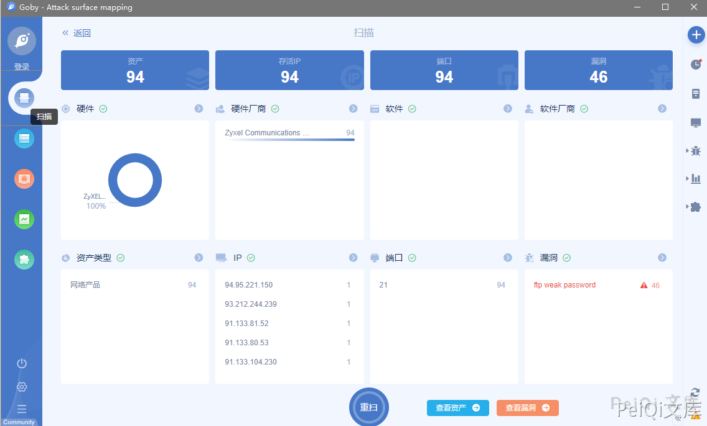
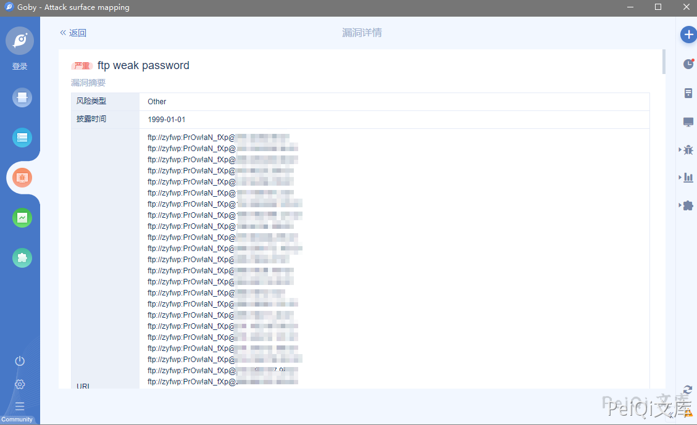

# Zyxel 硬编码后门账户漏洞 CVE-2020-29583

> 版本字段校订（2026-10-04）：代码、命令、路径、产品名或章节标记误入版本字段的值已逐字保存到对应 `previous_*` 字段；当前版本字段只记正文明确的来源范围，无范围时记为 unknown。后文对此元数据误填的旧说明描述校订前状态，其余实验条件与待核项仍按原文保留。

<!-- article-review:devices:begin -->
## 技术校订与证据边界（2026-10-02）

- 产品/组件：Zyxel USG/ATP/NXC/USG FLEX/VPN
- 本文讨论：CVE-2020-29583
- 版本、权限与配置前提：管理服务可达；固件版本缺失
- 资料类型：硬编码账户预警PoC；本次仅核对归档正文，未执行 PoC、未请求目标，未把原作者的“复现成功”继承为本库验证结果

### 逐项校订

- NCX/USG FIEX产品拼写错；版本字段仅系列名
- 7.8评分未给体系/来源；称FTP后门与实际管理登录服务关系需明确
- 无官方修复矩阵，扫描截图不能取代版本条件
- 已落实的文本修订：“USG FIEX”改为“USG FLEX”。上列仍描述旧文问题时，以此落实项及下列限定为准；修订不代表运行验证

### 操作风险与恢复

- 本篇未提供足以确认无副作用的完整验证流程；应依正文所述配置、权限与交互前提评估，不能把通告或截图当成可直接运行的检测脚本

### 待核与来源

- CVSS、服务入口和固件版本待核验
- 引用图片未查看，截图内容及有效性待核验
- 文内原始链接和图片引用继续保留；未检查图片像素、未下载或执行外部附件。版本边界、修复/在野状态及厂商归属若缺一手依据，均不能视为本次已确认
- 下方保留原技术正文与载荷；其中历史时间表述和成功主张应按本节限定阅读
<!-- article-review:devices:end -->


## 漏洞描述

Zyxel固件中发现的后门被称为关键固件漏洞，CVE编号CVE-2020-29583，得分为7.8 CVSS。虽然CVSS评分看似不是很高，但却不可小觑。研究人员表示，这是一个极为严重的漏洞，所有者必须立即更新其系统。因为任何人都可以轻松利用这个漏洞，从DDoS僵尸网络运营商到勒索软件团体和政府资助的黑客。

通过滥用后门账户，网络罪犯可以访问易受攻击的设备并感染内部网络以发起其他攻击。攻击者可以使用管理特权登录设备，并轻易破坏网络设备。

参考阅读：

- [scan_CVE-2020-29583](https://github.com/2d4d/scan_CVE-2020-29583)
- [Zyxel USG Series 账户硬编码漏洞（CVE-2020-29583）](https://www.seebug.org/vuldb/ssvid-99089)

## 漏洞影响

```
Zyxel USG系列

Zyxel ATP系列

Zyxel NCX系列

Zyxel USG FLEX系列

Zyxel VPN系列
```

## 网络测绘

```
title="USG40"

"NXC2500" 等
```

## 漏洞复现

分析固件中有 FTP 的后门密码




使用[漏洞扫描脚本](https://github.com/2d4d/scan_CVE-2020-29583)找到易受攻击的版本




进行攻击，登录为后门管理员账户 **zyfwp:PrOw!aN_fXp**

这里使用Goby设置字典扫描即可







---

> 来源：Threekiii/Vulnerability-Wiki（https://github.com/Threekiii/Vulnerability-Wiki）


## Zyxel CVE-2020-29583 硬编码账号的历史版本对照

本篇与既有硬编码账号主文属于 CVE-2020-29583 同一实体，补充的是固件比较与版本边界，不计作新漏洞。CNA 指定 USG 4.60 含密码不可修改的 zyfwp 账号，凭据明文存在于固件，能用于 SSH 或 Web 管理登录；不能把其名称中的 ftp 字样直接当成 FTP 专属漏洞。

原文比较 4.39 和 4.60；前者有账号名称但未设置相同密码，并不足以证明也受同一缺陷影响。Zyxel 官方社区明确仅运行 4.60(XXXX.0) 的相关防火墙版本受影响，4.60(XXXX.1) 不受此问题影响。这是该历史漏洞的边界，不表示当前所有安全问题都已解决。

文章中的 2020 年修复和 2021 年计划日期是历史状态。官方 NXC 热修复公告已经存在，因此不能继续把 NXC 修复写为尚在等待计划。各产品分支应依官方公告区分，不将 USG 的 4.60 版本套给 NXC。

源正文开头已有的掩码和后文完整公开凭据均维持原稿，不作脱敏或猜补；本文没有重写来源代码、启动扫描或尝试登录。


### 逐项静态审计

- 4.39 中存在账号名称不等于存在相同可登录硬编码密码。
- 既有扫描脚本/字典尝试不参与本次检查；本次是版本和服务类型的文献校正。
- 来源开头的既有掩码和后文凭据不作修改；4.60防火墙矩阵不可套给NXC。

### 核验、风险与来源

管理登录可能获取高权限并产生审计记录；后续配置更改不属于只读验证。本次仅进行公开资料与既有文库的静态文字核对，未执行请求、载荷、固件、依赖安装或扫描，也未访问示例目标。来源中的成功或失败是作者记录；截图像素本轮未审，不将其升级为本库复现。

本文为新写中文分析，不整篇复制原文章或图片。汇编库的 Apache-2.0 声明不能证明原作者文章及图片已按该许可授权。原始资料不作遮盖、替换或删除；本文没有转录为可运行脚本，也不补全来源省略的参数。

- 研究来源：0431物联卫士实验室，https://www.iotsec-zone.com/article/350；发布时间线索：unknown。本次仓库收录时间不等于新漏洞披露时间
- 核对依据：https://github.com/CVEProject/cvelistV5/blob/main/cves/2020/29xxx/CVE-2020-29583.json
- 核对依据：https://community.zyxel.com/en/discussion/5396/is-my-zywall-usg-vpn-atp-usg-flex-firmware-version-affected-by-cve-2020-29583-how-to-check
- 核对依据：https://community.zyxel.com/en/discussion/5424/hot-fix-for-cve-2020-29583-is-available-now

- 固定汇编来源（仅固定所读版本，不代替原作者出处）：https://github.com/Mr-xn/Penetration_Testing_POC/blob/f33600e512f2ff654ec335102daf23b8a5218d24/iot/%E8%B6%85%E5%8D%81%E4%B8%87Zyxel%E8%AE%BE%E5%A4%87%E8%A2%AB%E6%9B%9D%E5%AD%98%E5%9C%A8%E9%AB%98%E5%8D%B1%E6%BC%8F%E6%B4%9E.md
