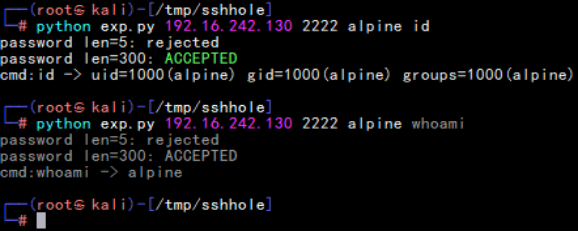

<!-- vulwiki-editorial:start -->
## 校订与适用边界

### 本次收录记录
- 2026-11-17 周维护收录：来源 gelusus/wxvl 公众号漏洞文库；文本全文审阅完成；未执行任何 PoC、依赖安装或目标访问。
- 触发材料（请求/指纹/规则）保留在下方原文中，未做脱敏或删改。
- CVE/产品查重：无重复主入口（本库 master 6314 篇正文级搜索无既有条目）

### 尚未解决的证据缺口
- 影响版本为来源声明，未与厂商公告逐一核对
- 复现截图像素未查看，技术结论以原文文字为准
- 修复状态为来源声明，需按分支核对补丁版本
<!-- vulwiki-editorial:end -->

## 技术正文与历史材料

> 以下为来源原文全文（保留原始字节，含广告与联系方式的保留原文）。

#  【已复现】OpenSSH/musl密码认证绕过漏洞（CVE-2026-123158）  
NS-CERT
                    NS-CERT  绿盟科技CERT   2026-11-06 10:03  
  
**通告编号 NS-2026-0027**  
  
2026-11-06  
  
<table><tbody><tr><td data-colwidth="100" width="100" valign="top" style="border-color: rgb(216, 216, 216);margin: 0;word-break: break-all;padding: 5px;"><strong><span style="font-size: 14px;color: #333;"><span leaf="">TAG：</span></span></strong></td><td valign="top" style="border-color: rgb(216, 216, 216);margin: 0;word-break: break-all;padding: 5px;"><p><strong style="caret-color: red;"><span style="font-size: 14px;" microsoft="microsoft" yahei="yahei"><span leaf="">OpenSSH/musl、认证绕过、CVE-2026-123158</span></span></strong></p></td></tr><tr><td data-colwidth="100" valign="top" style="border-color: rgb(216, 216, 216);margin: 0;word-break: break-all;padding: 5px;"><strong><span style="font-size: 14px;color: #333;"><span leaf="">漏洞危害：</span></span></strong></td><td valign="top" style="border-color: rgb(216, 216, 216);margin: 0;word-break: break-all;padding: 5px;"><p style="vertical-align: inherit;"><strong style="caret-color: red;font-size: 14px;line-height: 1.5em;" microsoft="microsoft" yahei="yahei"><span leaf="">攻击者利用此漏洞，可绕过SSH密码认证登录目标系统。</span></strong></p></td></tr><tr><td data-colwidth="100" valign="top" style="border-color: rgb(216, 216, 216);margin: 0;word-break: break-all;padding: 5px;"><strong><span style="font-size: 14px;color: #333;"><span leaf="">版本：</span></span></strong></td><td valign="top" style="border-color: rgb(216, 216, 216);margin: 0;word-break: break-all;padding: 5px;"><p style="vertical-align: inherit;"><strong style="caret-color: red;font-size: 14px;line-height: 1.5em;" microsoft="microsoft" yahei="yahei"><span leaf="">1.0</span></strong></p></td></tr></tbody></table>  
  
**1**  
  
  
**漏洞概述**  
  
  
近日，绿盟科技CERT监测到OpenSSH发布安全更新，修复了OpenSSH/musl密码认证绕过漏洞（CVE-2026-123158）；由于musl libc的crypt()在失败时会返回"*"，当目标账户的密码字段为"*"、系统中存在其他使用密码哈希的账户且启用SSH密码认证时，未经身份验证的攻击者可通过提交超长密码使musl crypt()的错误返回值与目标账户密码字段错误匹配，从而绕过密码认证并登录目标账户；若该账户具备sudo/doas权限，攻击者还可进一步获取系统root权限。CVSS评分8.1，目前漏洞细节与PoC已公开，请相关用户尽快采取措施进行防护。  
  
OpenSSH是SSH（Secure SHell）协议的免费开源实现，提供sshd、ssh、sftp等组件，广泛用于远程登录、文件传输和安全隧道；musl libc是面向Linux系统的轻量级C标准库，常见于Alpine Linux等环境。  
  
绿盟科技天机实验室已成功复现此漏洞：  
  
  
  
  
参考链接：  
  
https://www.openssh.org/txt/release-10.6p2  
  
  
**SEE MORE →**  
  
**2****影响范围**  
  
### 受影响版本  
  
• 7.3p1 <= OpenSSH < 10.6p2  
  
注：  
影响使用musl libc且未启用PAM进行密码认证的Linux系统，重点关注Alpine Linux及符合条件的OpenWrt、Buildroot、Yocto系统、Docker镜像和容器。  
  
### 不受影响版本  
  
• OpenSSH >= 10.6p2  
  
  
**3****漏洞检测**  
  
### 3.1 人工检测  
  
用户可以通过检查OpenSSH版本、C运行库类型及相关配置来判断当前系统是否在受影响范围内：  
### 检查OpenSSH版本命令：  
```
ssh -V
```  
  
检查系统是否使用musl libc：  
```
ldd /usr/sbin/sshd
```  
### 检查SSH配置：  
```
*检查主配置文件：grep -iE 'PasswordAuthentication|UsePAM' /etc/ssh/sshd_config*检查子配置目录（如有）：grep -iE 'PasswordAuthentication|UsePAM' /etc/ssh/sshd_config.d/* 2>/dev/null
```  
  
若当前版本在受影响范围内，且PasswordAuthentication为yes，系统未启用PAM，则可能存在安全风险。  
  
  
**4****漏洞防护**  
  
### 4.1 官方升级  
  
目前官方已发布新版本修复此漏洞，请受影响的用户尽快升级版本进行防护，下载链接：https://www.openssh.com/portable.html  
  
### 4.2 其他防护措施  
  
在不影响业务的情况下，相关用户可使用下列措施进行临时缓解：  
  
1、在/etc/ssh/sshd_config中设置PasswordAuthentication no并重启sshd，禁用SSH密码认证；  
  
2、将PermitRootLogin设置为prohibit-password或no。  
  
  
**END**  
  
  
  
  
  
**声明**  
  
本安全公告仅用来描述可能存在的安全问题，绿盟科技不为此安全公告提供任何保证或承诺。由于传播、利用此安全公告所提供的信息而造成的任何直接或者间接的后果及损失，均由使用者本人负责，绿盟科技以及安全公告作者不为此承担任何责任。  
  
绿盟科技拥有对此安全公告的修改和解释权。如欲转载或传播此安全公告，必须保证此安全公告的完整性，包括版权声明等全部内容。未经绿盟科技允许，不得任意修改或者增减此安全公告内容，不得以任何方式将其用于商业目的。  
  
  
  
  
**绿盟科技CERT**  
∣  
微信公众号  
  
  
  
  
  
长按识别二维码，关注网络安全威胁信息

---

> 来源：gelusus/wxvl 公众号漏洞文库（原文见文首链接，归档 URL 见 frontmatter source_url）